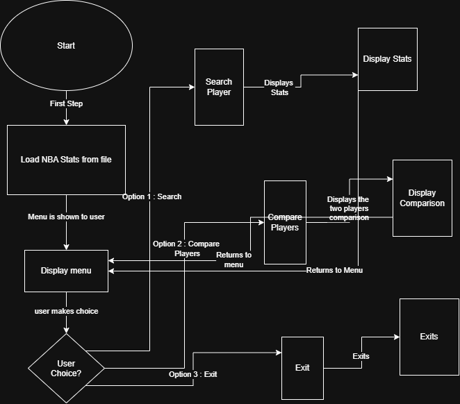

# Project Name : NBA-Stats-Project

The goal of this project is to create a Java program that makes it easier to search for and compare NBA players using statistics from previous seasons.

## The Problem

I want to solve the problem that sometimes comparing NBA players across different seasons can be time consuming and hard to look at. Usually, it takes a while to compare players and identify various trends among both players and teams.

## How It Works

-The program loads NBA player statistics from a CSV file.
- The user can search for a player to see their stats or choose two players to compare.
- The program displays the results and returns to the main menu so the user can search again.

## Tech Stack

- **Language:** Java
- **Libraries:** Scanner, BufferedReader, Arrays
- **External tools:** Git, IntelliJ

## Setup

- Download and install IntelliJ.
- Clone the GitHub repository and open the project in IntelliJ.
- Make sure the NBA statistics CSV file is in the data folder.
- Run the main Java file to start the program.

## Usage

- Select an option from the menu.
- Enter a player to view their statistics.
- Choose the comparison option and enter two player names to compare their stats.
- View the results and return to the menu or exit.

## Roadmap

Compare stats from across multiple seasons 
Display league leaders in various stats
Compare overall team statistics

## Author

Krishna Autade 
https://github.com/

How It Works: 

How It Works: 

